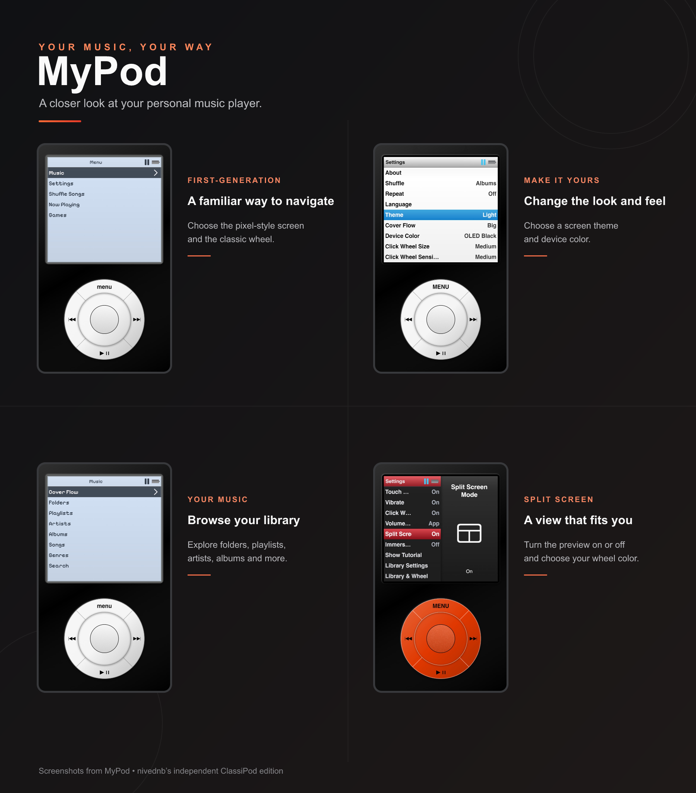

# MyPod

**Your music, your way.**

An offline-friendly music player with a nostalgic click wheel and a look you can make your own.

*[Open MyPod](https://nivednb.github.io/MyPod/) · [How to install](docs/personal-player.md) · [Credits & license](#credits--license)*

## Make it yours

Import your music and playlists, choose your favorite theme and wheel, and take
your library offline. MyPod also includes Brick, Snake, 2048 and Solitaire.

Scan to open MyPod, or [open it in your browser](https://nivednb.github.io/MyPod/).
On iPhone, use **Share → Add to Home Screen**.

The earlier [Classipod link](https://nivednb.github.io/Classipod/) remains
available as a compatibility copy for existing installations. It is a snapshot;
new updates appear on the MyPod link. Home Screen installations may have
separate storage, so keep the original app and your source files until you have
verified your library in a new installation.

Each person imports their own files; the link does not share your music.
Browser storage can be cleared by the device, so keep a copy of your originals.
See the [web app guide](docs/personal-player.md) for setup, offline storage,
playlist imports, supported formats and troubleshooting. For detailed features
and platform notes, see the [player reference](docs/player-reference.md).

## Credits & license

MyPod is an independent web edition developed under the direction of
[nivednb](https://github.com/nivednb), with AI-assisted implementation and
iterative testing and feedback. It builds on the original
[ClassiPod](https://github.com/adeeteya/Classipod) by
[Aditya R](https://github.com/adeeteya) and its contributors.

This product includes software developed by Aditya R. The original
[BSD-4-Clause license](LICENSE) remains intact. Third-party assets may have
separate terms. MyPod is not an official release endorsed by Apple or the
original project. See [credits and rights notes](docs/credits-and-rights.md).

Icon attribution: [iPod icons created by Freepik - Flaticon](https://www.flaticon.com/free-icons/ipod).
